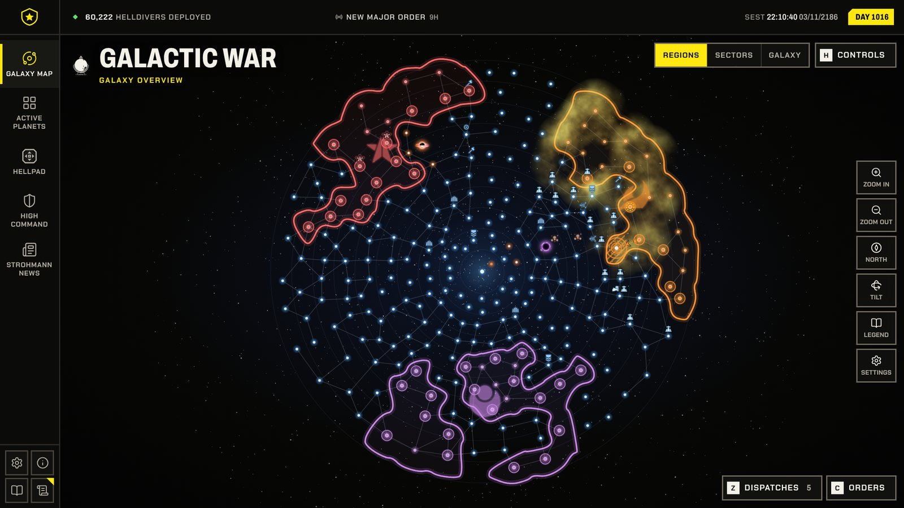
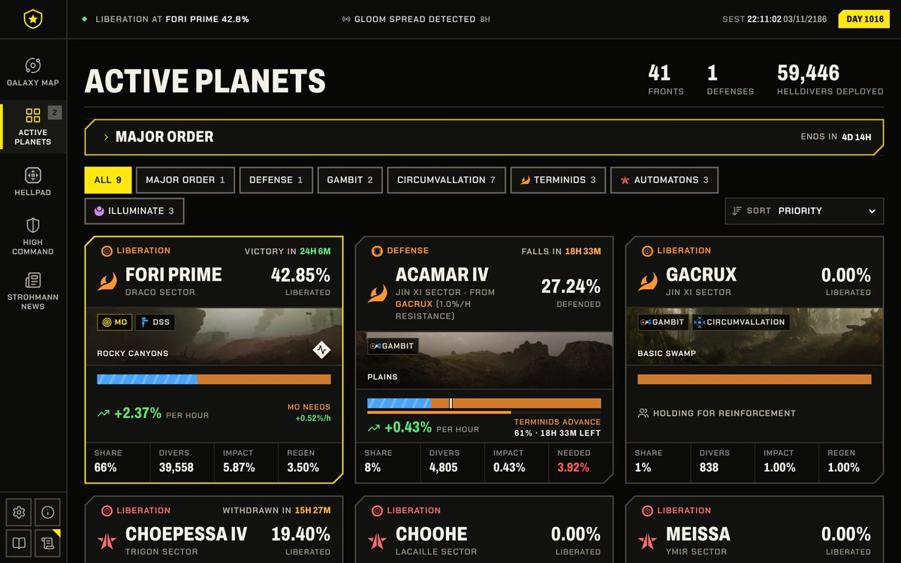
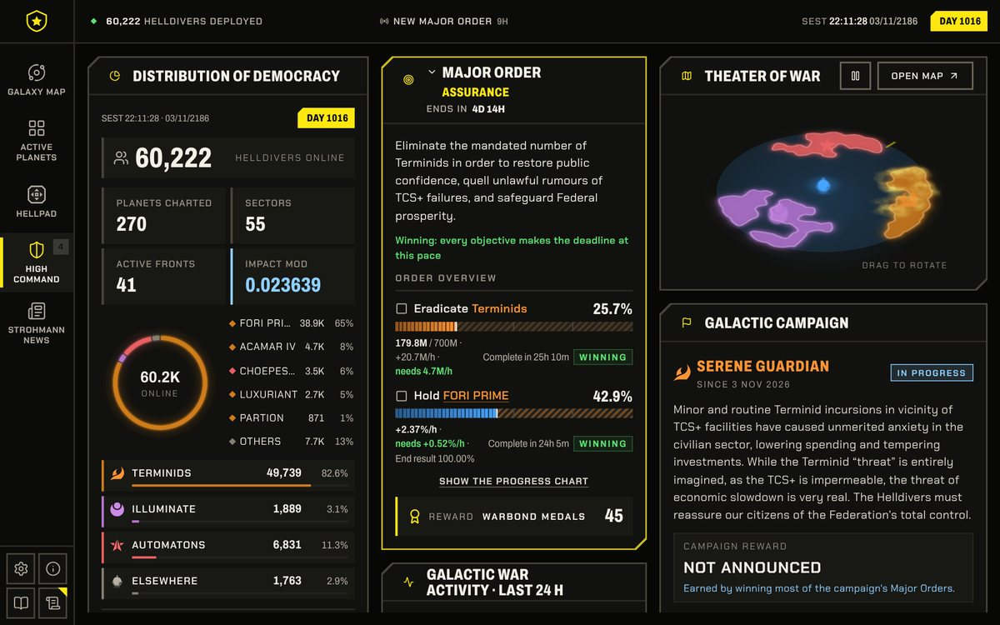
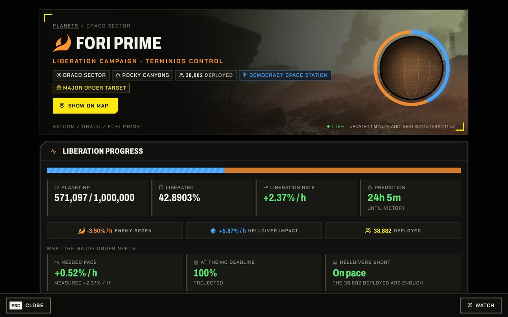
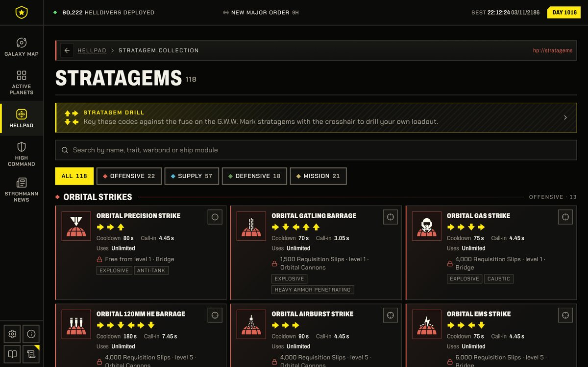

# WarCommand Tracker

**A fan-made companion for the Galactic War of Helldivers 2.** 
What is being fought, where, how fast the fronts move, what the Major Order needs and what has changed.

[**Open in your browser**](https://zearkreast.github.io/WarRoom/) &nbsp;·&nbsp;
[**Download**](https://github.com/zearkreast/WarRoom/releases/latest) &nbsp;·&nbsp;
[What's new](CHANGELOG.md)

## What's inside

<table>
<tr>
<td width="50%" valign="top">

<h3>Active planets</h3>
Every front as a card: progress, pace, time to victory or the deadline, and Helldivers. Sort by priority, most
needed, most Helldivers or soonest victory, and filter by enemy, Major Order, defense, gambit, circumvallation or
your watchlist.
</td>
<td width="50%" valign="top">

<h3>High Command</h3>
The Major Order with a live outlook for each objective and the pace it needs, the Galactic Campaign, a turning
Theater of War and the war's activity over the last day.
</td>
</tr>
<tr>
<td width="50%" valign="top">

<h3>Planet pages</h3>
Liberation or defense, what holding or the Major Order needs, the front line over the last day and the next,
cities, enemy units and effects, supply lines, and the planet's war history back to the war's first days.
</td>
<td width="50%" valign="top">

<h3>Stratagems</h3>
All 118 stratagems by permit and type, with code, cooldown, call-in time and where each is unlocked, and a drill
that has you key the codes against a burning fuse.
</td>
</tr>
</table>

And more:

- **Galaxy map**: regions, sectors and the whole galaxy, supply and attack lines, the Gloom, and holograms for
  sub-factions, SEAF and the Democracy Space Station. Hover a planet for its card, click it to dock a panel.
- **Hellpad**: a planet index, the space stations and their tactical actions, past Galactic Campaigns and the
  G.W.W., an in-universe net of training manuals, ministries, corporations, holidays and logs.
- **Strohmann News**: every dispatch and campaign story, newest first, searchable.
- **Alerts**: new Major Orders and campaigns, the order's progress, dispatches, planets won or lost, new defenses
  and the planets on your watchlist, in the app or as system notifications.
- **While you were away**: what changed since you last looked.

## Get it

| Platform    | What to download                                                                     |
| ----------- | ------------------------------------------------------------------------------------ |
| **Web**     | Nothing: open [zearkreast.github.io/WarRoom](https://zearkreast.github.io/WarRoom/)  |
| **Windows** | the `.exe` installer, or the `.msi`                                                  |
| **macOS**   | the `.dmg`: `aarch64` for Apple Silicon, `x64` for Intel                             |
| **Linux**   | the `.AppImage`, `.deb` or `.rpm`                                                    |
| **Android** | the `.apk`                                                                           |

Every file is on the [latest release](https://github.com/zearkreast/WarRoom/releases/latest). Once installed, the
app offers each new version itself: on desktop it downloads, installs and restarts in one press; on Android it
downloads the new APK for the system to install.

**Private by design.** No account, no analytics, no tracking: your settings and watchlist stay on your device.
See [PRIVACY.md](PRIVACY.md).

## How it works

A small collector reads the war's status around the clock and keeps it, with its history, in a shared database;
the app only reads from that database. Everything is written in Rust: the app is Leptos compiled to WebAssembly,
inside a Tauri 2 shell on desktop and Android.

To build it, run it yourself or release a version, see [docs/DEVELOPMENT.md](docs/DEVELOPMENT.md); for running
your own collector, [collector/README.md](collector/README.md).

## Feedback

Found a bug or missing something? [Open an issue](https://github.com/zearkreast/WarRoom/issues). Security problems
go privately, as [SECURITY.md](SECURITY.md) describes.

## Licence

The project's own code is under the [GNU General Public License v2](LICENSE). A fan project, not affiliated with
Arrowhead Game Studios or Sony Interactive Entertainment. These parts aren't covered by that licence and keep
their own terms:

- **The game's material:** the pictures, icons, logos and adverts in `src/assets/`, and the names and lines quoted
  from the game. They belong to Arrowhead Game Studios and Sony Interactive Entertainment and aren't offered for
  reuse.
- **Text adapted from the Helldivers Wiki:** the pages in `crates/core/src/data/` stay under
  [CC BY-NC-SA 4.0](https://creativecommons.org/licenses/by-nc-sa/4.0/), so they can't be used commercially.
- **Effect names:** `crates/core/data/planet-effects.json` comes from
  [helldivers-2/json](https://github.com/helldivers-2/json), under the
  [MIT licence](crates/core/data/LICENSE-planet-effects).
- **Fonts:** each keeps the licence beside it in `src/assets/fonts/`.

If something here is yours and you want it credited differently or taken down, open an issue.
